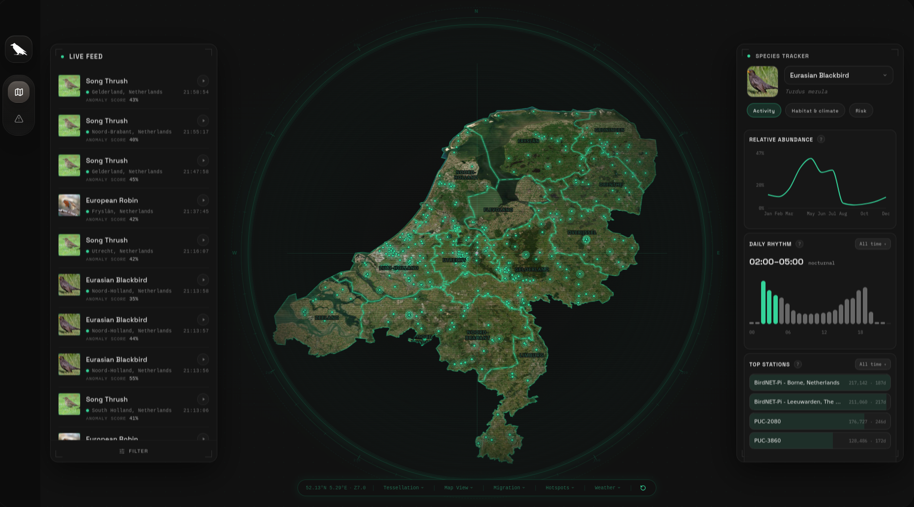
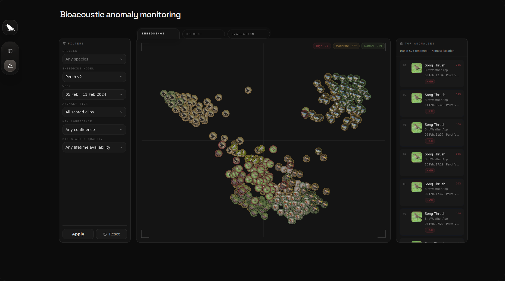
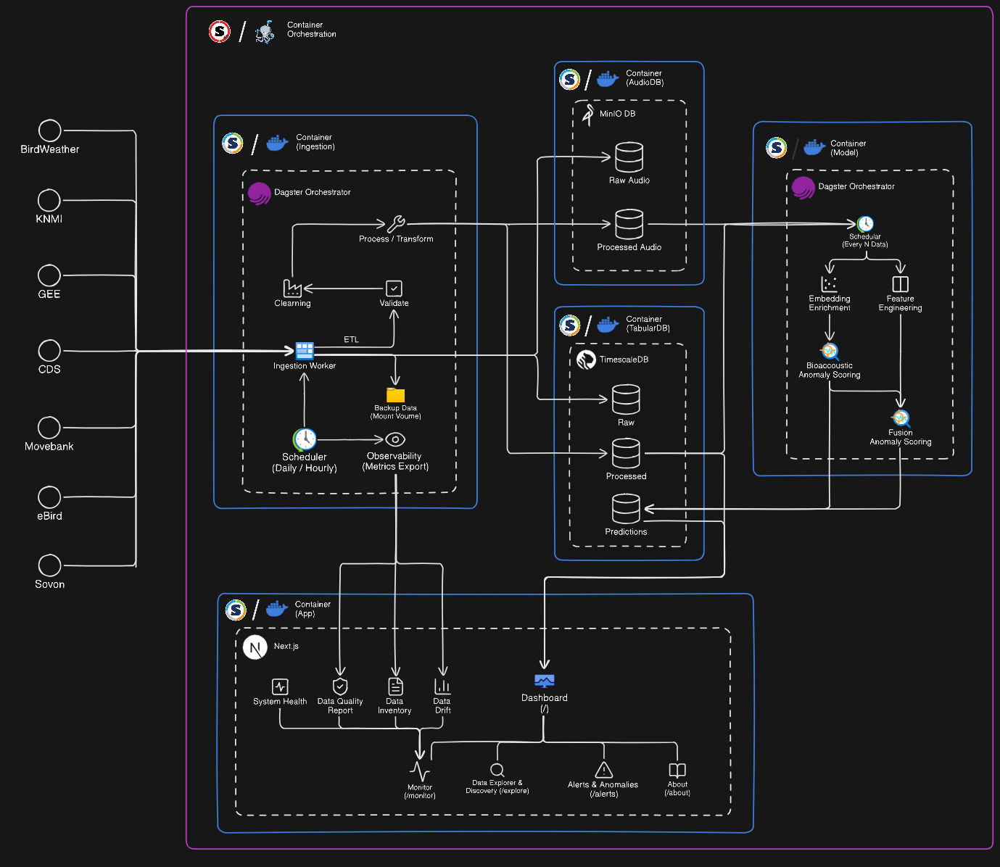

# Avian Biosurveillance

**A passive-acoustic early-warning platform for unusual changes and mortality in Dutch bird populations, built entirely on public data.**

The platform turns continuous, citizen-science bird-audio recordings into a weekly, spatially-resolved anomaly signal that helps ecologists decide *which species, locations, and weeks are worth a closer look* - before a change becomes visible in reported bird mortality. It is a decision-support tool for expert review, **not** a disease-diagnosis system.



## Why

Sick or stressed birds tend to call less and produce altered songs, so a sustained, unusual change in a population's acoustic and detection activity can act as an indirect early-warning signal. Watching bird populations acoustically can therefore give advance notice of die-offs and other population-level stress before they show up in mortality reports.

## What it does

- **Live detection feed & map** - recent BirdWeather detections across the Netherlands, in space and time.
- **Species tracker** - activity trends for the 11 tracked species (7 targets, 4 controls), over time and across the map.
- **Weekly anomaly alerts** - a ranked anomaly score per species per 5×5 km grid cell, fusing bioacoustic, population-activity, and environmental signals.
- **Alert review tools** - inspect a flagged clip's spectrogram, waveform, and audio; compare it against historical examples; cluster alerts spatially; and check alignment against SOVON mortality reports.



## How it works

1. **Ingest** - BirdWeather is the primary source (detections + audio); KNMI weather, Google Earth Engine, and CDS drought add environmental context. SOVON mortality is used only as an evaluation reference, never as a training label. Each ingested source runs on its own Dagster schedule.
2. **Quality** - a post-ingestion layer checks completeness, temporal continuity, and audio validity, then writes flags that downstream jobs filter on, so an alert can be traced to biology rather than a data fault.
3. **Process** - raw soundscapes are cropped to the BirdNET detection window and stored as mono FLAC; a background-sound classifier tags privacy-sensitive audio (speech, traffic); mel-spectrograms and waveforms are rendered for the dashboard.
4. **Embed** - BirdNET and Perch v2 turn each clip into an acoustic embedding.
5. **Score** - three weekly signals are fused with an Isolation Forest into a ranked anomaly score per species × grid cell × week: bioacoustic drift (cosine distance to historical same-species/week embeddings), effort-normalized population-activity anomalies (robust median/MAD against prior years), and lagged environmental context.
6. **Serve** - a read-only Next.js dashboard presents the live data and alerts for expert review.

## Architecture

A container-based stack where each service runs independently:



| Service | Role |
|---|---|
| `timescaledb` | Structured/time-series tabular storage (PostgreSQL + hypertables) |
| `minio` | Object storage for raw/processed audio, spectrograms, waveforms, features |
| `ingestion` | Pulls data from all sources |
| `model` | Feature engineering, embeddings, anomaly scoring, tuning |
| `dagster` | Schedules and runs the workflows |
| `frontend` | Serves the Next.js dashboard |

The repository has three code surfaces:

- **`src/avian_biosurveillance/`** - Python ingestion, processing, features, modeling, and Dagster orchestration.
- **`db/`** - PostgreSQL/TimescaleDB schema, routines, and tooling (the source of truth for the schema).
- **`frontend/`** - the Next.js 15 dashboard.

## Tech stack

- **Backend** - Python · Poetry · pandas/NumPy · scikit-learn/statsmodels · BirdNET (birdnetlib) · Perch v2 · PyTorch/TensorFlow/Hugging Face · librosa/soundfile/FFmpeg · xarray/netCDF4
- **Data & orchestration** - TimescaleDB/PostgreSQL · MinIO · Dagster
- **Frontend** - Next.js 15 · React 19 · TypeScript · Tailwind CSS · MapLibre GL / react-map-gl · Recharts
- **Runtime** - Docker / Docker Compose (local & cloud) · Singularity/Apptainer (on-premise)

## Getting started

The full local stack runs from Docker Compose:

```bash
bash infrastructure/docker/compose.sh up -d
```

See **[infrastructure/docker/README.md](infrastructure/docker/README.md)** for prerequisites, environment files, and service details, and **[infrastructure/singularity/README.md](infrastructure/singularity/README.md)** for the on-premise (HPC) deployment. For development commands (tests, linting, type-checks), see `scripts/tooling/code_quality.sh` in **[scripts/README.md](scripts/README.md)**.

## Documentation

- **[docs/sphinx/](docs/sphinx/)** - overview, architecture, data pipeline, modeling & evaluation, deployment, and the API reference generated from docstrings (`cd docs/sphinx && make html`)
- Per-area READMEs under `src/avian_biosurveillance/*/`, `db/`, `scripts/`, and `infrastructure/`

## Evaluation

The anomaly signal is evaluated against reported bird-mortality counts from SOVON at national per-species monthly resolution (SOVON has no coordinates, so it is not scored per grid cell). It shows a positive rank association with SOVON mortality nationally; part of that lead is seasonal, since it also appears in the control species. Because the data carries no clip-level disease labels, the model is unsupervised and its output is a prioritization signal for expert review rather than a classifier. See **[docs/sphinx/modeling-and-evaluation.rst](docs/sphinx/modeling-and-evaluation.rst)** for the methodology and caveats.

## Status

Research prototype. The stack is heavier than it needs to be; see
**[ROADMAP.md](ROADMAP.md)** for the plan to simplify it (DuckDB + Parquet,
no object storage, two containers) and prepare it for a larger user base.

## License

[MIT](LICENSE)

