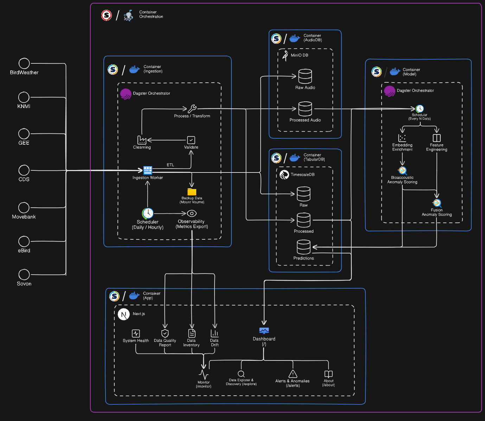

Architecture
============

The platform uses a container-based design. Each service runs independently, so
it can be developed, restarted, or replaced without affecting the rest.

Services
--------

.. list-table::
   :header-rows: 1
   :widths: 22 78

   * - Service
     - Role in the system
   * - ``timescaledb``
     - Stores structured, time-series tabular data (PostgreSQL + hypertables).
   * - ``minio``
     - Stores file artifacts: raw audio, processed clips, spectrograms, waveforms, and feature files.
   * - ``ingestion``
     - Pulls data from the external sources.
   * - ``model``
     - Runs feature engineering, embeddings, anomaly scoring, and tuning.
   * - ``dagster``
     - Triggers scheduled and sensor-based workflow runs.
   * - ``frontend``
     - Serves the Next.js dashboard.

Storage design
--------------

The platform separates two storage responsibilities because it combines
high-volume tabular data with large binary objects. **TimescaleDB**, a
PostgreSQL extension optimized for time-series workloads, holds structured
records; high-volume tables are hypertables partitioned by time for efficient
queries over specific weeks, species, or grid cells. **MinIO**, a self-hosted
S3-compatible object store, holds the file artifacts. The database stores
references and metadata for each object so every file links back to its
detection, processing step, or model output.

Code surfaces
-------------

The repository has three code surfaces:

* ``src/avian_biosurveillance/`` — Python ingestion, processing, features, modeling, and Dagster orchestration.
* ``db/`` — the PostgreSQL/TimescaleDB schema and tooling (source of truth for the schema).
* ``frontend/`` — the Next.js 15 dashboard.

System diagram
--------------

