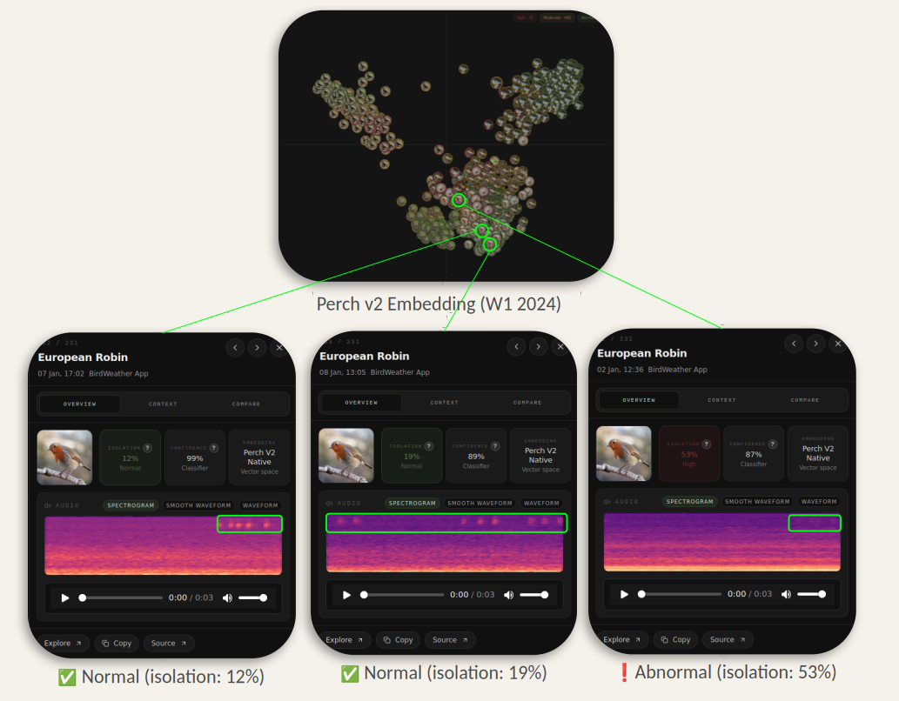

Modeling and evaluation
=======================

The anomaly signal
------------------

The modeling step combines audio embeddings, environmental variables, and
population activity into a **weekly anomaly score for each target species in
each 5×5 km grid cell**. Because there are no clip-level labels indicating
whether a bird was infected or healthy, the model is unsupervised: it learns
what normal activity and sound patterns look like from historical data, then
ranks weeks that differ from that baseline. The output is a decision-support
signal, not a disease diagnosis.

Three signals are fused:

**Bioacoustic drift.**
Each processed clip is represented by a BirdNET or Perch v2 embedding. For a new
clip, the system measures cosine distance to the nearest earlier clips of the
same species and calendar week from previous years, using the same grid cell and
time-of-day context when enough data is available. Clips that sound close to the
baseline score low; unusual clips score higher. Where a local baseline is too
small, the search widens so sparse cells can still be scored.

**Population activity.**
This branch uses weekly species-tracker rows derived from BirdWeather detections
rather than audio. Because the number of active stations changes over time, it
uses effort-normalized features — relative abundance, temporal occupancy,
station presence, and detections per active station-day — compared against the
same calendar week in previous years with robust statistics (median and median
absolute deviation), so unusual drops or spikes are visible without being
dominated by outliers.

**Environmental context.**
Lagged weather and drought values provide continuous context for the acoustic
and population signals, without acting as standalone alert drivers.

The fusion step combines all three in an **Isolation Forest**, producing a
ranked weekly anomaly score that tells experts which species, cells, and weeks
are worth reviewing.

Evaluation
----------

The anomaly signal is evaluated against reported bird-mortality counts from
SOVON at a national per-species monthly level. SOVON records carry no
coordinates, so they are not scored per 5×5 km grid cell. The signal shows a
positive rank association with SOVON mortality at the national level; part of
that lead is seasonal, since it also appears in the control species.

Because the data carries no clip-level disease labels, evaluation relies on
weak, indirect references rather than supervised validation, and the result is
a prioritization signal for expert review rather than a classifier.
